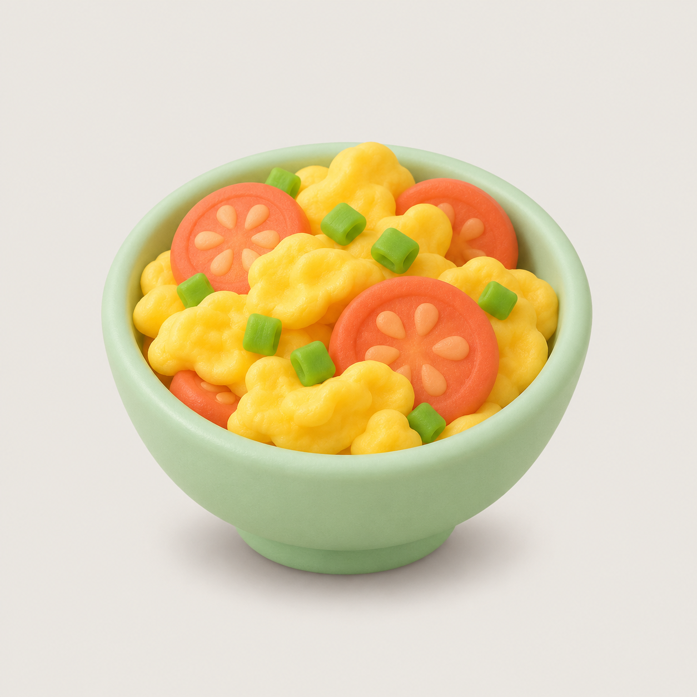

# 鲸鱼娘食谱 · dsh-whale-recipe

给 DeepSeek Harness 装一个**悬浮菜谱墙**：右下角一颗鲸鱼按钮，点开是 116 道菜的黏土风插画，
悬停出现「复制」，点卡片看味觉/香气/质地/温度参数，拖进 QQ 就能直接投喂。



## 它是什么

- **116 道菜**：大米饭 8 / 中餐 57 / 西餐 29 / 饮品·甜品 22，来自 `kids_menu_multimodal_v0.1` 合成数据集。
- **插画**：Codex 内置 imagegen 批量生成，黏土盲盒质感，统一 #EDEAE4 背景、统一三分之四俯视、无文字无手。
- **感官参数**：味觉峰值、香气通道、质地、温度曲线，全部是**规则生成的合成示例，不是实测**。

## 安装

```bash
# 在本机安装（DSH 会重启桌面端加载插件）
```

插件市场：

```
git+https://github.com/<owner>/<repo>.git#<commit>
```

或直接用 `install_dsh_plugin` 工具安装上面的 spec。

## 用法

| 操作 | 结果 |
|---|---|
| 点右下角 🐳 | 打开/收起菜谱墙 |
| 点分类胶囊 | 过滤（全部 / 大米饭 / 中餐 / 西餐 / 饮品\甜品） |
| 悬停卡片 → 「复制」 | 图片进剪贴板，微信/QQ 里 Ctrl+V 直接贴 |
| 点卡片 | 进参数页：味觉四条、温度区间、质地与香气 Top2 |
| 拖动卡片 | 拖进 QQ 窗口直接当图片/文件发送 |

> 浏览器沙箱下，微信 PC 不接受拖拽（它只认资源管理器递过来的真实文件），
> 所以微信建议走「复制 → 粘贴」；QQ 与资源管理器都支持拖拽。

## 权限与范围

- 只消费 `webserver/index-inject` 组合事件，注入一段 style + 一段 script。
- **不注入任何 Service**，不读写业务数据，不发网络请求。
- 截图/剪贴板等动作全部发生在浏览器页面内，由用户手势触发。

## 仓库结构

```
lib/index.js        宿主半边：注入 style + script（唯一有逻辑的文件）
lib/panel.js        面板半边：shadow root 里渲染菜谱墙
lib/panel.css       面板样式（跟随 DSH 主题变量）
lib/boot.css        页面级锚点（0×0，负责 z-index）
lib/data.js         116 道菜 + 160px 插画 data URI（构建产物）
cordis.patch.yml    profile 层：把宿主半边挂上去
```

## 数据与许可

- **代码**：MIT。
- **数据与插画**：CC0-1.0。感官数值为规则生成的合成示例，不可当作实测或营养依据。
- 菜名仅作指称，不含任何品牌方的关联或授权。

## 构建

```bash
python build_data.py    # whale-menu-all.json + output/imagegen/all/*.png -> lib/data.js
```
